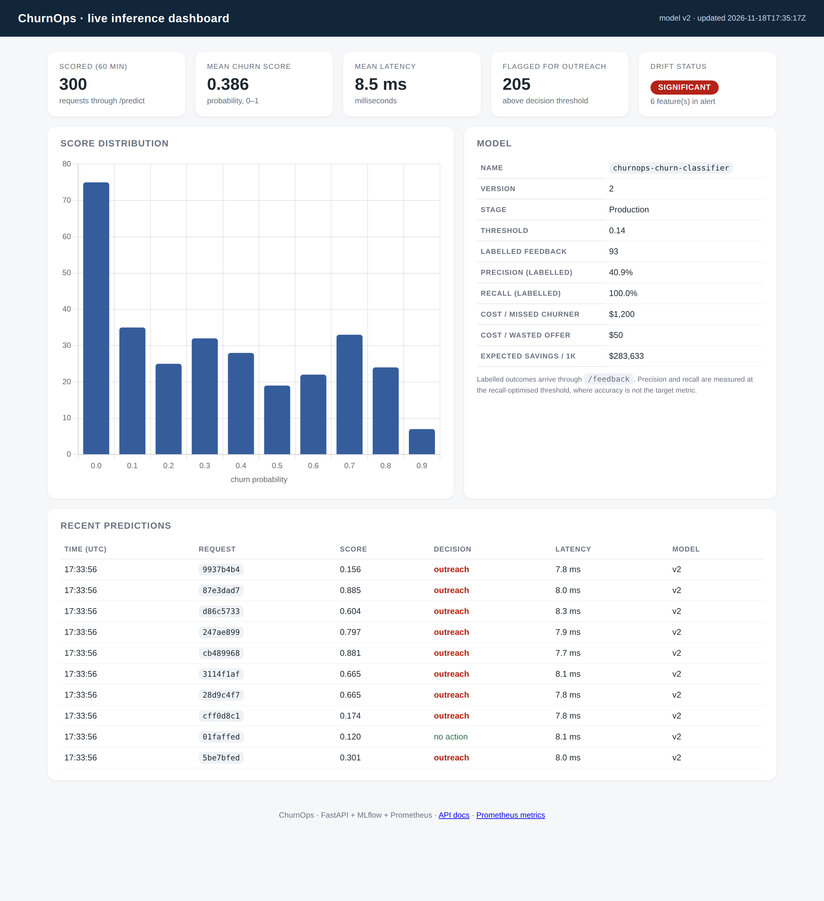
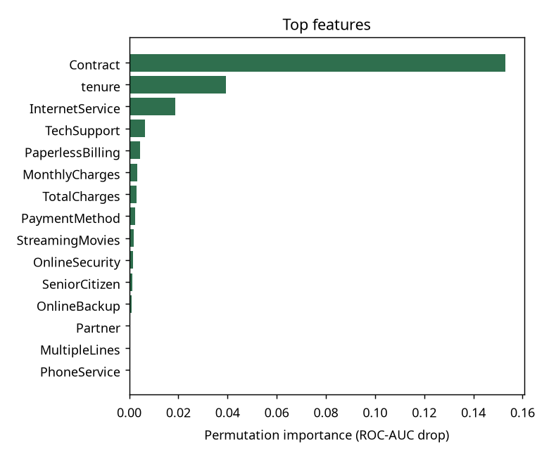
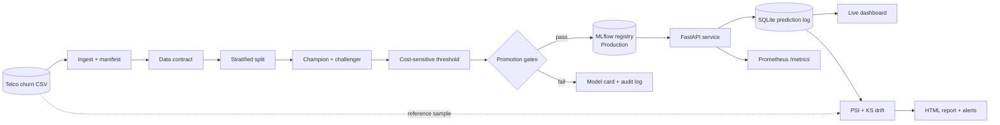
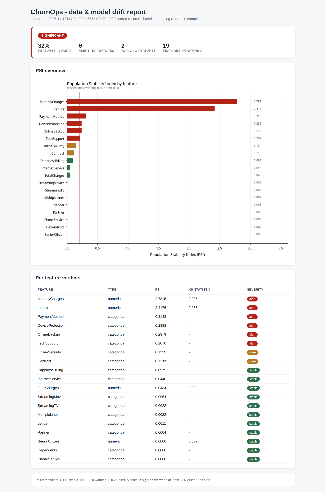

# ChurnOps

**A churn prediction platform with the boring parts done properly: data contracts, a model registry with real promotion gates, drift monitoring, and a free-tier deployment that anyone can open in a browser.**




Most portfolio ML projects stop at `model.fit()`. This one runs the full lifecycle: a failing data contract stops the pipeline, a model only reaches Production if it beats explicit gates, every prediction is logged, drift is measured against the training distribution, and a failing drift check opens a GitHub issue on a schedule. It runs end to end in about ten seconds and costs nothing to host.

---

## The problem

A subscription business wants to know which customers are about to leave so it can send a retention offer. Two mistakes are expensive in opposite directions: missing a churner loses their remaining lifetime value, while pestering a happy customer wastes an offer. The model therefore has to be good at ranking a rare positive class, and the *decision* has to be tuned to the business cost of each error.

That framing drives every design choice in this repository.

## Results (held-out test split, 1,057 customers)

| Metric | Champion: histogram gradient boosting | Challenger: logistic regression |
| --- | --- | --- |
| PR-AUC | **0.6616** | 0.6579 |
| ROC-AUC | 0.8394 | **0.8446** |
| Recall @ operating threshold | **0.9573** | 0.9858 |
| Precision @ operating threshold | **0.3690** | 0.3515 |
| F1 | **0.5327** | 0.5182 |
| Brier score | **0.1584** | 0.1629 |
| Decision threshold | 0.14 | 0.11 |

The champion is selected on **validation** PR-AUC, so the test numbers above stay an honest estimate. The challenger wins on ROC-AUC, which is exactly why both are trained and logged on every run instead of quietly picking one.

At the cost-optimal threshold the confusion matrix is 269 true positives, 460 false positives, 316 true negatives and 12 false negatives. Against a "contact nobody" baseline that costs $319,016 per 1,000 customers, the model's expected cost is $35,383 - a saving of roughly **$283,633 per 1,000 customers (88.9%)** under the stated assumptions ($1,200 lost CLV per missed churner, $50 per wasted offer).



The drivers are the ones a retention team would expect: contract type, tenure and fibre-optic internet service. That sanity check matters more than a third decimal of AUC.

## What makes this an MLOps project, not a notebook

| Capability | Where it lives | What it actually does |
| --- | --- | --- |
| Data contracts | `src/churnops/data/validate.py` | 10 checks (schema, domains, ranges, nulls, duplicates, leakage); critical failures stop the run before training |
| Reproducibility | `data/ingest.py`, `config.py` | SHA-256 manifest for the dataset, fixed seeds, one command rebuilds everything |
| Experiment tracking | `training/train.py` | MLflow run per model with params, metrics, ROC/PR curves, confusion matrix and the model artefact |
| Model registry + gates | `training/registry.py` | Promotion to Production requires PR-AUC >= 0.60, recall >= 0.65, Brier <= 0.20 and clean validation |
| Governance | `docs/model_card.md`, `artifacts/audit_log.jsonl` | Generated model card plus an append-only audit trail of every promotion decision |
| Serving | `src/churnops/serving/` | FastAPI with Pydantic contracts, batch endpoint, feedback endpoint, Prometheus metrics, hot reload |
| Monitoring | `src/churnops/monitoring/` | PSI + KS drift per feature, standalone HTML report, Slack alerts, live dashboard |
| CI/CD | `.github/workflows/` | Lint, tests, smoke pipeline, image build, GHCR publish, scheduled drift check with issue creation |
| Infrastructure as code | `infra/terraform/` | Optional Cloud Run stack with scale-to-zero and an instance cap |
| Operations | `docs/runbook.md` | What to do when drift fires, a gate fails, the API is unhealthy, or feedback looks wrong |

## Architecture



Full diagrams, sequence flows and the repository map are in [docs/architecture.md](docs/architecture.md).

## Quickstart

Requires Python 3.11+ (3.12 tested). No cloud account, no Docker, no MLflow server.

```bash
git clone https://github.com/imSheheryar/churnops.git
cd churnops
make install            # virtualenv + editable install with dev extras
source .venv/bin/activate

churnops pipeline       # ingest -> validate -> train -> log -> gate -> promote
churnops serve          # API on http://localhost:8080
```

Then open:

- `http://localhost:8080/dashboard` - live inference dashboard
- `http://localhost:8080/docs` - OpenAPI documentation
- `reports/drift_report.html` - drift report from the last batch scored

Generate demo traffic so the dashboard has something to show:

```bash
python scripts/generate_demo_traffic.py --url http://localhost:8080 --count 300
```

The pipeline prints a stage-by-stage summary and writes `reports/metrics.json`, `reports/experiment_summary.json`, `reports/validation_report.json`, `docs/model_card.md` and an audit entry.

## Using the API

```bash
curl -s -X POST http://localhost:8080/predict \
  -H 'content-type: application/json' \
  -d @scripts/payload_example.json
```

```json
{
  "request_id": "2edc2ea7-9d46-4768-8a68-0676d5b308e4",
  "churn_probability": 0.8568,
  "decision": true,
  "threshold": 0.14,
  "risk_band": "high",
  "model_version": "1",
  "latency_ms": 36.84
}
```

Batch scoring and the feedback loop that powers the dashboard's precision and recall:

```bash
curl -s -X POST http://localhost:8080/predict/batch \
  -H 'content-type: application/json' \
  -d '{"customers": [ ... ]}'

curl -s -X POST http://localhost:8080/feedback \
  -H 'content-type: application/json' \
  -d '{"request_id": "2edc2ea7-...", "actual": 1}'
```

| Endpoint | Purpose |
| --- | --- |
| `GET /health` | Liveness and model readiness (separate signals) |
| `GET /model` | Deployed version, stage, threshold, feature list |
| `POST /predict` | Single customer score |
| `POST /predict/batch` | Up to 1,000 customers |
| `POST /feedback` | Attach the ground-truth label to a scored request |
| `GET /metrics` | Prometheus exposition |
| `GET /api/overview` | JSON behind the dashboard |
| `GET /dashboard` | Live HTML dashboard |
| `POST /admin/reload` | Hot-reload after a promotion |

Invalid payloads return a sanitised 422 (no `NaN` leaking into the response), which is the kind of detail that tends to break in production.

## Monitoring and drift

Score a batch and produce a shareable report:

```bash
python scripts/make_sample_batches.py     # writes stable + drifted demo batches
churnops drift --input data/sample/drifted_batch.csv
```

The command exits `2` when drift is significant, which is what makes it usable as a CI gate or a cron alert. A stable batch reports `stable`; the simulated drift batch reports `significant` with 6 alerting features (tenure, monthly charges, payment method, and three support/backup add-ons) and a drift share of 32%.



Thresholds follow the usual PSI convention: below 0.10 stable, 0.10-0.20 warning, above 0.20 alert. A batch becomes `significant` when at least 30% of monitored features alert, which avoids paging on a single noisy column.

## Deployment (zero cost)

Three paths, documented in [docs/adr/0004-free-tier-deployment.md](docs/adr/0004-free-tier-deployment.md):

**Hugging Face Spaces (default, no credit card).** The Space runs the same serving container on port 7860:

```bash
pip install huggingface_hub
export HF_TOKEN=hf_xxx
python scripts/deploy_hf_space.py --space-id your-username/churnops
```

Or run the `Deploy to Hugging Face Spaces` workflow manually with your Space id and an `HF_TOKEN` secret. The script stages the code, model artefacts and drift reports, then uploads them, so re-running it updates the live demo in place.

**GitHub Container Registry.** `publish-image.yml` builds and pushes on every push to `main`:

```bash
docker run -p 8000:8000 ghcr.io/<owner>/churnops:latest
```

**GCP Cloud Run (optional, needs a billing account).** Terraform provisions Artifact Registry, a runtime service account and a scale-to-zero Cloud Run service:

```bash
cd infra/terraform
cp terraform.tfvars.example terraform.tfvars
terraform init && terraform apply
```

The service caps at two instances and scales to zero, so the demo stays inside the free tier - but Google still requires billing on the project, which is why it is not the default.

Local container with Prometheus scraping the API:

```bash
docker compose up --build     # API on :8000, Prometheus on :9090
```

## Publish this repository

```bash
git init -b main
git add .
git commit -m "ChurnOps: churn prediction platform with data contracts, registry gates and drift monitoring"
gh repo create churnops --public --source=. --push
```

Without the GitHub CLI, create an empty repository in the browser and then:

```bash
git remote add origin https://github.com/<your-username>/churnops.git
git push -u origin main
```

The first push triggers CI. `publish-image.yml` pushes an image to GHCR using the
repository's `GITHUB_TOKEN`, so no extra secret is needed. For the Space
deployment, add an `HF_TOKEN` repository secret (Settings -> Secrets and
variables -> Actions) and run the `Deploy to Hugging Face Spaces` workflow.

## Tests and CI

```bash
make lint     # ruff check + format check
make test     # pytest
```

The suite covers the data contract (missing columns, duplicate ids, invalid targets, type coercion), the feature contract (split integrity, stratification, transformer output shape, unseen categories), the drift maths (PSI on identical vs shifted distributions, simulated drift), and the API (health, metadata, single and batch prediction, validation errors, feedback, metrics, dashboard feed).

CI runs lint, the unit tests, a 2,000-row smoke pipeline, the API tests against the trained model, and a Docker build that is started and probed with a real `/predict` call. The scheduled `Drift monitor` workflow rebuilds the reference model, scores a drifted batch, uploads the HTML report and opens an issue labelled `drift` when the verdict is significant.

## Repository layout

```
src/churnops/        package: config, data, training, monitoring, serving
pipelines/           end-to-end orchestration with stage timings
scripts/             demo traffic, sample batches, HF deployment, CI summary
tests/               data contracts, drift maths, API integration
docker/              Dockerfile + Prometheus scrape config
deploy/hf-spaces/    Space Dockerfile and metadata
infra/terraform/     optional Cloud Run stack
docs/                architecture, runbook, ADRs, model card, screenshots
reports/             generated metrics, validation report, drift report
artifacts/           model, reference stats, plots, audit log
```

## Design decisions

- [ADR 0001](docs/adr/0001-champion-challenger.md) - champion/challenger training, validation-based selection
- [ADR 0002](docs/adr/0002-registry-promotion-gates.md) - promotion gates and an append-only audit log
- [ADR 0003](docs/adr/0003-cost-sensitive-threshold.md) - cost-sensitive threshold instead of 0.5
- [ADR 0004](docs/adr/0004-free-tier-deployment.md) - free-tier deployment strategy

## Limitations and next steps

The demo is deliberately honest about its edges. The dataset is a public snapshot, not a live feed, so the "production" traffic is simulated. SQLite is a fine store for a demo but would be BigQuery or Postgres at scale. Drift is measured on features, not on outcomes, because labels arrive late. The threshold assumes a fixed CLV, while a real retention programme would segment by customer value.

Next on the list: a feature store to share transformations with batch scoring, a proper experiment comparison UI, shadow deployment of challengers behind a traffic split, and outcome-based monitoring once labels mature.

## Author

Built by **Sheheryar Yousaf** as a portfolio project for MLOps and platform engineering roles. Licensed under the MIT License.
