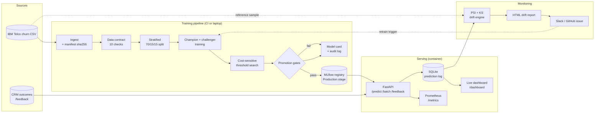
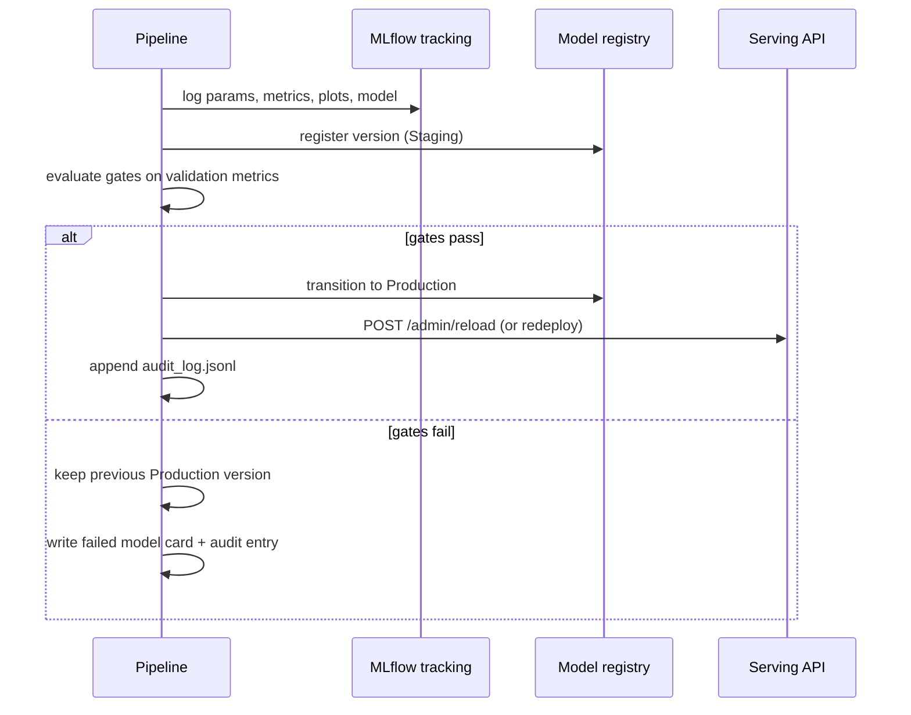
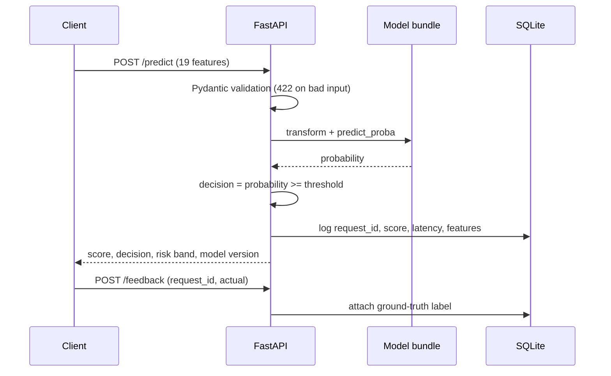
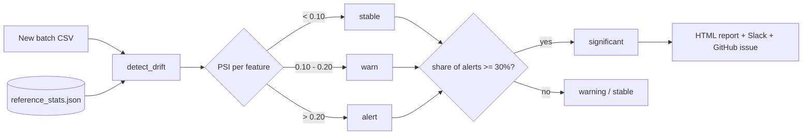
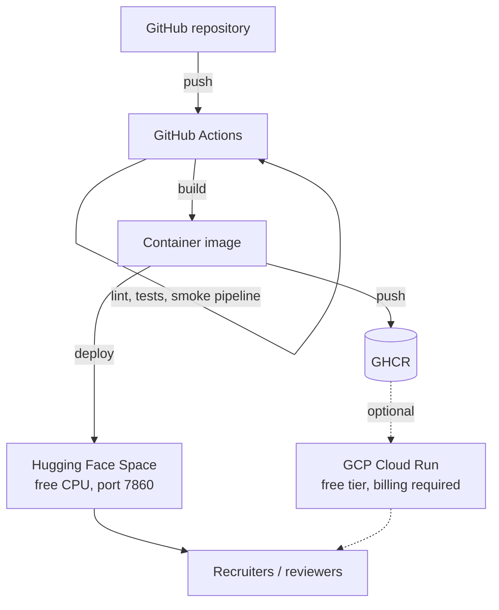

# Architecture

ChurnOps is a small but complete MLOps platform: data contracts, reproducible
training, a model registry with promotion gates, a serving API, and monitoring
that closes the loop back into training. Everything runs on free infrastructure.

## System context



## Training pipeline

The pipeline is a single command (`churnops pipeline`) and fails closed: a
critical data-contract failure stops the run before any model is fitted.

| Stage | Module | What it guarantees |
| --- | --- | --- |
| Ingest | `data/ingest.py` | Downloads the dataset once, records a SHA-256 manifest, falls back to a seeded synthetic frame when offline |
| Validate | `data/validate.py` | Required columns, row count, unique IDs, target domain, categorical domains, numeric ranges, null rates, leakage checks |
| Split | `data/features.py` | Stratified 70/15/15 split with a fixed seed; the test split is touched once, at the end |
| Train | `training/train.py` | Champion (histogram gradient boosting) vs challenger (logistic regression) on identical folds |
| Evaluate | `training/evaluate.py` | ROC-AUC, PR-AUC, F1, Brier, log loss, confusion matrix, cost-optimal threshold, expected savings |
| Register | `training/registry.py` | Logs params, metrics, plots and the model to MLflow; writes the model card and an append-only audit log |
| Gate | `training/registry.py` | Promotion requires PR-AUC >= 0.60, recall >= 0.65, Brier <= 0.20 and no critical validation failures |

Champion selection uses **validation PR-AUC**, never test metrics, so the test
split stays an honest estimate. The challenger is always trained and logged,
which makes "we tried the simpler model" an auditable fact rather than a claim.

## Model registry and promotion



Every promotion writes an audit entry with the run id, metrics, threshold and
gate decisions. `artifacts/audit_log.jsonl` is append-only and is the artefact an
auditor would ask for.

## Serving

The API loads the promoted model from `artifacts/model.joblib` (baked into the
image) and falls back to the MLflow registry when a tracking server is
configured. Preprocessing is the *same* fitted `ColumnTransformer` that was
trained, so there is no train/serve skew by construction.



Endpoints: `/health`, `/model`, `/predict`, `/predict/batch` (up to 1,000 rows),
`/feedback`, `/metrics`, `/api/overview`, `/dashboard`, `/admin/reload`.

## Monitoring

Two signals are tracked.

**Operational** - request count, latency histogram, score distribution, flagged
rate and labelled precision/recall, exposed as Prometheus series and rendered on
the dashboard.

**Statistical** - population stability index (PSI) per feature against the
training reference, plus a two-sample Kolmogorov-Smirnov test for numeric
features. A batch is `warning` when any feature crosses 0.10 and `significant`
when at least 30% of monitored features cross 0.20. Reports are standalone HTML
files so they can be attached to a ticket or a GitHub issue without a server.



## Deployment topology (free tier)



Hugging Face Spaces is the default because it needs no credit card: the Docker
SDK runs the same image used everywhere else, on a free CPU instance. Cloud Run
is provided as Terraform for teams that already have a billing account, with
`max_instances` and scale-to-zero as cost guardrails.

## Repository layout

```
src/churnops/
  config.py            settings + paths (pydantic-settings, env overridable)
  data/                ingest, contracts, features
  training/            train, evaluate, registry gates, model card
  monitoring/          drift engine, HTML report, prediction store, batch job
  serving/             FastAPI app, schemas, model store
pipelines/run_pipeline.py   end-to-end orchestration with stage timings
scripts/               demo traffic, sample batches, HF deployment, CI summary
tests/                 contracts, drift maths, API integration
infra/terraform/       optional Cloud Run stack
deploy/hf-spaces/      Space Dockerfile + metadata
docs/                  architecture, runbook, ADRs, model card, screenshots
```
